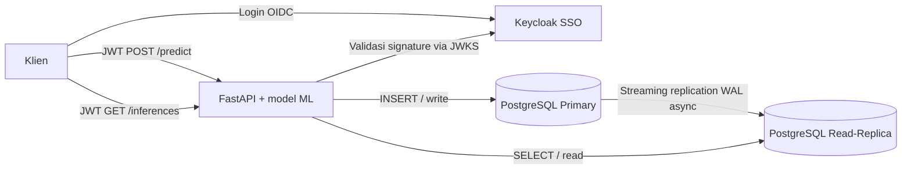

# UTS SBDT — Bagian III: Proyek Terintegrasi

**Mahasiswa:** Marcel Immanuel  
**NIM:** 20240801117  
**Mata kuliah:** Sistem Basis Data Terdistribusi  
**Dosen:** Imam Sutanto, S.Kom., M.Kom.  
**Tahun ajaran:** 2026/2027

> Proyek demonstrasi akademik. Password, akun, domain `.lokal`, mode `start-dev`, dan data pelatihan sintetis **hanya untuk praktik**, bukan produksi. **Jangan mengunggah berkas berisi password sungguhan**. Belum ada pengujian Docker/Kubernetes end-to-end pada saat paket ini disusun; bukti pengujian harus diambil setelah dijalankan.

## REVISI LAPORAN BERDASARKAN RUBRIK

Laporan teknis di `docs/Laporan_Teknis_SBDT_Bagian_III_Marcel_Immanuel.pdf` telah direvisi dengan rincian bukti untuk bobot **Docker 20%, Kubernetes/PVC 25%, SSO 20%, model/replikasi 20%, dan Git/laporan 15%**. Baca `PANDUAN_MAC_PEMULA.md` untuk langkah praktikum. Semua bukti runtime masih **BELUM DIUJI** dan harus berasal dari screenshot asli saat demonstrasi.

**Kekurangan teknis yang belum dituntaskan:** konfigurasi Ingress sudah ada, tetapi controller Ingress belum terpasang. Proyek bukan otomatis failover.

## Gambaran sistem



Model contoh menggunakan **Logistic Regression** dengan fitur nominal transaksi, jumlah transaksi 24 jam, dan apakah perangkat baru. Dataset **sintetis**, sehingga output hanya membuktikan alur inferensi, **bukan rekomendasi keputusan perbankan**.

## Isi berkas

| Berkas | Fungsi |
|---|---|
| `Dockerfile` | Multi-stage build: dependency wheels, latih model, runtime non-root |
| `compose.yaml` | PostgreSQL primary, PostgreSQL replica, Keycloak, FastAPI |
| `app/main.py` | API dengan JWT/JWKS, POST write primary, GET read replica |
| `app/train_model.py` | Membuat artefak ML dari data sintetis |
| `db/01-init-primary.sh` | Menyiapkan akun replikasi dan `pg_hba.conf` |
| `db/02-schema.sql` | Tabel riwayat inferensi dan indeks |
| `db/start-replica.sh` | `pg_basebackup -R`, streaming replica dan recovery |
| `keycloak/realm-sbdt.json` | Realm, client, audience mapper, dan akun demo |
| `k8s/*.yaml` | Namespace, ConfigMap, Secret, Service, StatefulSet, Deployment, Ingress |
| `scripts/smoke_test.sh` | Contoh request dari login hingga read/write |
| `scripts/probe_replication.sh` | Mengecek primary/recovery/replikasi |
| `tests/*.py` | Unit test ML dan perlindungan endpoint |
| `docs/diagram-arsitektur.png` | Diagram arsitektur |

## 1. Menjalankan secara lokal (Docker Compose)

**Prasyarat:** Docker Desktop dengan Compose v2, akses internet saat mengambil image, RAM kosong sekitar 4–6 GB, Python 3 untuk mengolah JSON di skrip uji. Dalam Windows, skrip `.sh` bisa dijalankan melalui Git Bash atau WSL.

Buka Terminal/PowerShell pada folder proyek dan jalankan:

```bash
docker compose up -d --build
docker compose ps
```

Tunggu sampai Keycloak memuat realm (bisa beberapa saat). Periksa status:

- Dokumentasi API: http://localhost:8000/docs
- Status API: http://localhost:8000/health
- SSO: http://localhost:8080/realms/sbdt/.well-known/openid-configuration
- Keycloak admin (demo): http://localhost:8080 — `admin` / `admin_demo_password`
- Pengguna demo: `marcel` / `Demo12345!`

Jalankan uji:

```bash
bash scripts/smoke_test.sh
bash scripts/probe_replication.sh
```

Apabila token gagal ditemukan, cek `docker compose logs keycloak` dan tunggu realm siap. Apabila Keycloak pernah dijalankan dengan realm bernama sama, hapus volume *khusus lingkungan demonstrasi* agar realm diimpor ulang (perintah hapus volume akan menghapus data dan hanya dilakukan jika aman).

### Alur uji manual

1. Ambil JWT dari endpoint token Keycloak dengan client `sbdt-cli` dan akun demo. Endpoint password grant hanya dipakai untuk **smoke test lokal**; untuk aplikasi sesungguhnya gunakan Authorization Code + PKCE.
2. Kirim `POST /predict` dengan Authorization Bearer JWT. Periksa response `201`, header `X-Write-Node: postgres-primary`, dan `id` hasil.
3. Kirim `GET /inferences` dengan token yang sama. Periksa header `X-Read-Node: postgres-replica` dan data. Karena **asynchronous replication**, pembacaan mungkin tertunda singkat.
4. Jalankan `scripts/probe_replication.sh`. Yang diharapkan: primary `pg_is_in_recovery() = f`, replica `= t`, dan `pg_stat_replication.state = streaming`.
5. Pemeriksaan keamanan: request `POST /predict` tanpa token seharusnya mengembalikan **401**.

Contoh payload:

```json
{"transaction_amount": 12500000, "transactions_24h": 9, "new_device": true}
```

**Catatan:** Header menunjukkan routing yang dipilih aplikasi, sedangkan verifikasi `pg_is_in_recovery()` dan statistik WAL memberikan bukti DB yang sesungguhnya.

## 2. Menjalankan di Kubernetes (Minikube atau Kind)

**Prasyarat:** Kubernetes lokal dan `kubectl`, dynamic StorageClass default untuk PVC. Ingress nginx hanya wajib jika ingin mengakses `auth.lokal` dan `api.lokal` dari browser; uji dasar bisa menggunakan `kubectl port-forward`. Pastikan Docker image API dibuat dulu.

```bash
docker build -t sbdt-api:local .
# PILIH SESUAI CLUSTER:
# kind load docker-image sbdt-api:local --name <nama-cluster>
# atau: minikube image load sbdt-api:local
kubectl apply -f k8s/00-namespace.yaml
kubectl apply -f k8s/
kubectl -n sbdt-uts get pods,svc,pvc,ingress
kubectl -n sbdt-uts rollout status statefulset/postgres-primary
kubectl -n sbdt-uts rollout status statefulset/postgres-replica
kubectl -n sbdt-uts rollout status deployment/keycloak
kubectl -n sbdt-uts rollout status deployment/api
```

**Jika memakai Kind:** ganti `<nama-cluster>` dengan nama klaster Anda (misalnya `kind` jika default). Jika image tidak ditemukan, periksa `kind load`, nama tag `sbdt-api:local`, dan `imagePullPolicy: IfNotPresent`.

Untuk uji tanpa Ingress, buka **dua terminal**:

```bash
# Terminal A
kubectl -n sbdt-uts port-forward svc/keycloak 8080:8080
# Terminal B
kubectl -n sbdt-uts port-forward svc/api 8000:8000
```

Untuk token yang diterbitkan Kubernetes, claim issuer adalah `http://auth.lokal/realms/sbdt` (tidak sama dengan issuer Docker Compose), sehingga **jangan** menjalankan script uji dengan token Docker pada Kubernetes. `scripts/smoke_test.sh` mengambil token baru pada Keycloak yang sedang berjalan melalui port-forward dan dapat digunakan setelah service tersedia.

Untuk menguji Ingress sesuai permintaan soal, pasang NGINX Ingress Controller di cluster dengan panduan resminya lalu arahkan DNS/hosts `auth.lokal` dan `api.lokal` ke IP/endpoint ingress cluster. Domain ini hanya untuk lab; HTTPS dan DNS resmi diperlukan pada produksi. Kode SQL/API tidak menyimpan IP Pod.

### Bukti independensi fisik / persistence

```bash
kubectl -n sbdt-uts get pvc
kubectl -n sbdt-uts exec postgres-primary-0 -- \
  psql -U sbdt -d sbdt -c 'SELECT count(*) FROM inference_history;'
# Ambil screenshot jumlah baris sebelum delete dan setelah pod Ready kembali.
kubectl -n sbdt-uts delete pod postgres-primary-0
kubectl -n sbdt-uts rollout status statefulset/postgres-primary
kubectl -n sbdt-uts exec postgres-primary-0 -- \
  psql -U sbdt -d sbdt -c 'SELECT count(*) FROM inference_history;'
```

**Harapan:** PVC tetap Bound dan riwayat tetap ada meskipun Pod database dibuat ulang. Ini membuktikan persistence, **bukan otomatis failover**. Konfigurasi hanya memiliki primary yang dapat menulis; replica tidak otomatis dipromosikan ketika primary gagal. Jangan mengklaim auto-failover tanpa tambahan HA manager seperti Patroni.

## 3. Pengujian unit & dokumentasi

```bash
python -m pip install -r requirements-dev.txt
python -m pytest -q tests/
```

Catat hasil saat diuji dan simpan screenshot sendiri pada `docs/bukti/`. Daftar bukti wajib dan urutan pengambilan ada di `docs/BUKTI_PENGUJIAN.md`. Jangan memasukkan JWT lengkap atau password ke screenshot untuk publikasi.

## 4. Unggah ke GitHub / repositori Git

```bash
git init
git add .
git commit -m "UTS SBDT: distributed database SSO inference demo"
git branch -M main
git remote add origin https://github.com/<username>/<nama-repositori>.git
git push -u origin main
```

Ganti placeholder dengan URL repo yang **benar-benar dibuat** di GitHub. File ZIP proyek bukan URL repositori dan **belum menggantikan** ketentuan Git dari dosen.

## 5. Batasan keamanan dan implementasi

- Password pada Compose/Kubernetes manifest adalah **dummy publik**, wajib diganti jika di-deploy sungguhan.
- Keycloak `start-dev`, akun publik dengan direct grant, dan HTTP **hanya untuk demonstrasi**. Produksi perlu HTTPS, autentikasi Authorization Code + PKCE, database Keycloak permanen, rotasi secrets, jaringan terbatas, dan backup.
- Streaming replication asynchronous dapat menyebabkan *replication lag*. Tidak ada sistem promosi otomatis primary/failover.
- Model ML dilatih dari data buatan; tidak boleh dipakai untuk menilai nasabah nyata.
- Laporan PDF menyertakan **rancangan dan skenario pengujian**, bukan screenshot hasil eksekusi, karena environment penyusun belum menjalankan Docker/Kubernetes.

## Referensi teknis

- https://www.postgresql.org/docs/16/app-pgbasebackup.html
- https://www.postgresql.org/docs/16/runtime-config-replication.html
- https://www.keycloak.org/server/importExport
- https://www.keycloak.org/server/containers
- https://kubernetes.io/docs/concepts/workloads/controllers/statefulset/
